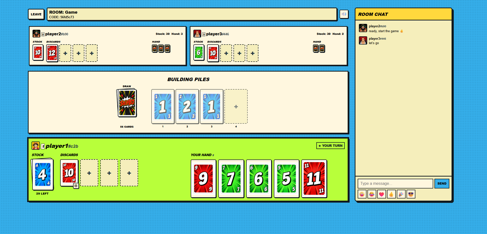
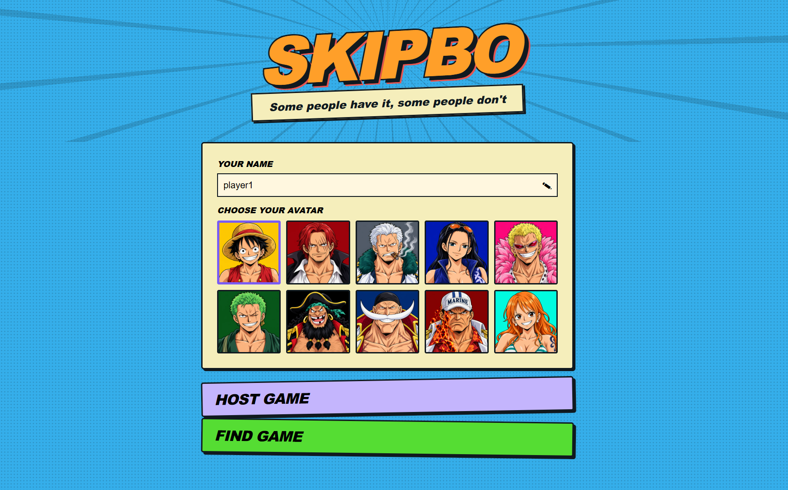
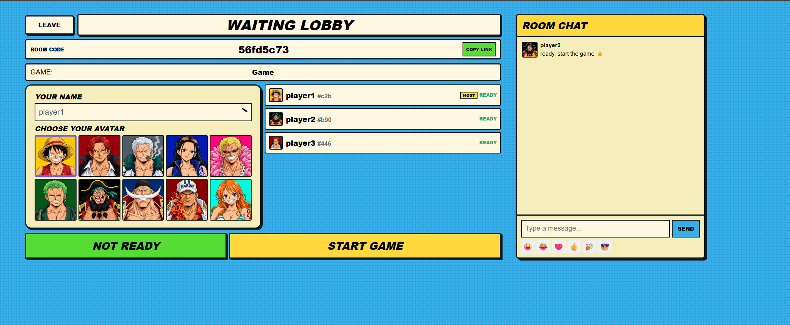
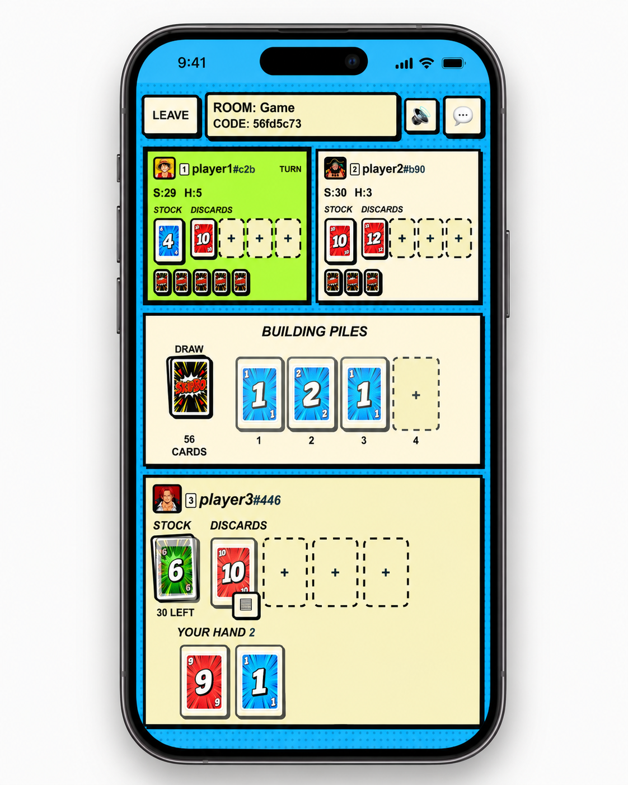

# SkipBo Multiplayer



## Description

A small, simple, in-memory SkipBo multiplayer game you can self-host and play with your friends in your browser.

Play with 2–6 players, create or join rooms, and chat in real time. No accounts or database required.

## Tech Stack

- **Backend:** Java 21, Javalin, WebSockets
- **Frontend:** SvelteKit, TypeScript
- **Deployment:** Executable JAR, Docker Compose, Cloudflare Quick Tunnel

## How to Run

Clone the repository:

```bash
git clone https://github.com/levo-m7/SkipBo-Multiplayer.git
cd SkipBo-Multiplayer
```

### Option 1 - Java 21

Requires Java 21 or newer.

```bash
java -jar skipbo-multiplayer.jar
```

### Option 2 - Docker

Requires Docker with Compose.

```bash
docker compose up -d --build
```

### Option 3 - Cloudflare Quick Tunnel (Testing)

Requires Docker with Compose.

Start SkipBo with a temporary public URL:

```bash
docker compose -f compose.tunnel.yml up -d --build
```

Get the generated public URL:

```bash
docker compose -f compose.tunnel.yml logs tunnel
```

Share the generated `https://...trycloudflare.com` URL with your friends.

The URL is temporary and may change when the tunnel restarts. No router port forwarding is required.

For local play, open **http://localhost:7070** in your browser.

## Notes

- All rooms, sessions, and game state are stored in memory and reset when the server restarts.
- For LAN multiplayer, use the host device's local IP address with port `7070`.
- Firewall or WSL port forwarding may be necessary depending on your network setup.
- Cloudflare Quick Tunnels are intended for temporary testing. Anyone with the public link can access the game while the tunnel is running.

## Screenshots

### Homepage



### Waiting Lobby



### Browser Gameplay


### Mobile Gameplay


